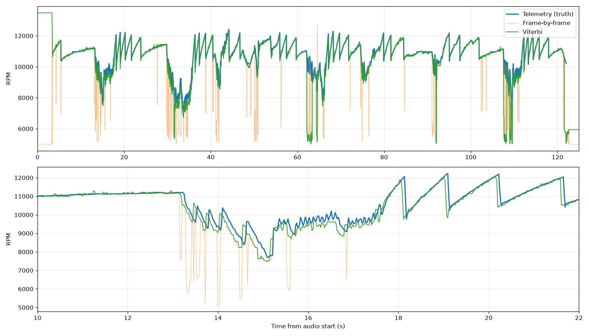
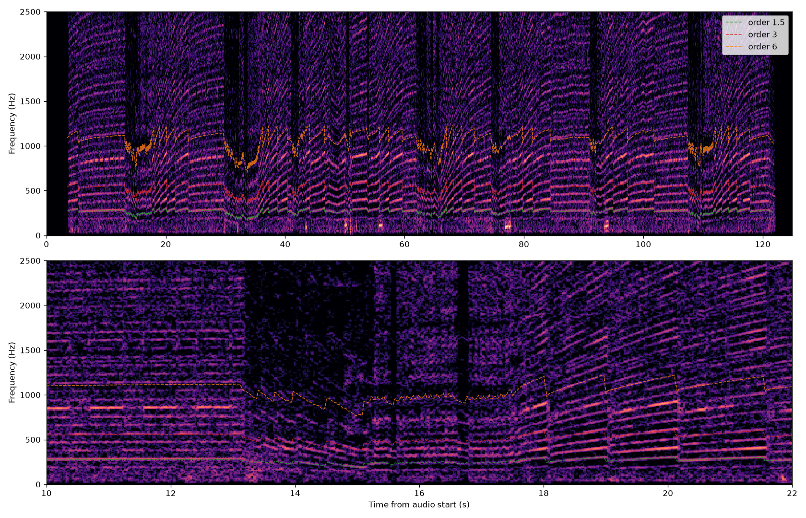
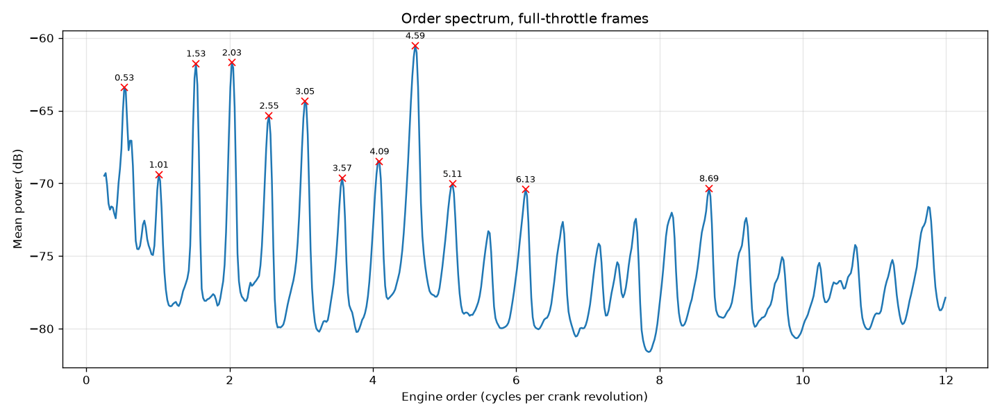
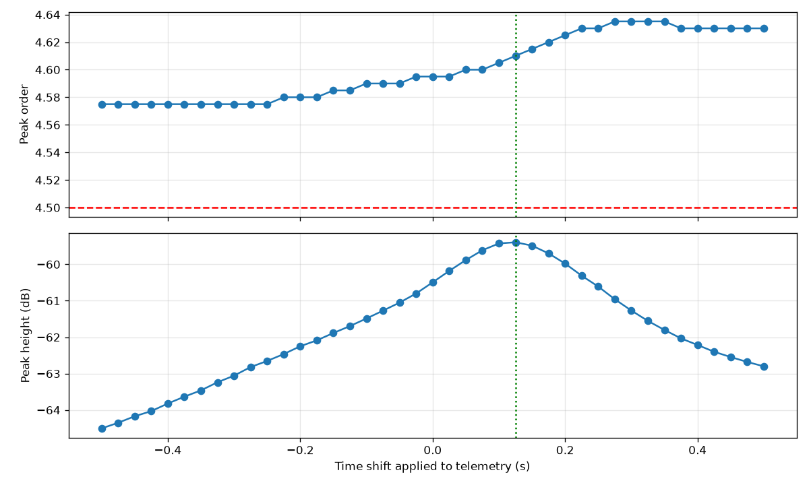
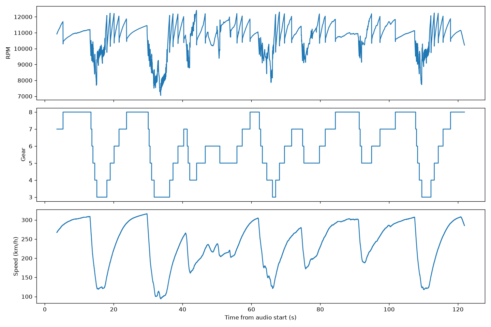

# Engine Sound → RPM

**Estimating an F1 car's engine speed from its sound alone, validated against live game telemetry.**

Can you tell how fast an engine is spinning just by listening to it? This project records the engine audio from *F1 26* together with the game's live UDP telemetry, then builds a signal-processing pipeline that estimates RPM from the audio alone and scores it against the telemetry as ground truth.

It combines acoustics, signal processing and motorsport data: the same ideas used in NVH (noise, vibration and harshness) engineering and in acoustic detection and tracking.

---

## Key findings

- **The engine sound has a clear four-stroke harmonic structure.** Order analysis shows peaks at every half engine order (0.5, 1.0, 1.5 … 6.0), which is what a real four-stroke engine produces, because each cylinder fires once every two crank revolutions.
- **Order 4.5 is the dominant harmonic**, followed by orders 1.5 and 2.0.
- **The game pitches its engine audio about 2.4% above the RPM it reports.** This offset stayed constant however the audio and telemetry were aligned, so it comes from the game's sound design, not from a timing error.
- **The audio arrives about 0.125 s after the telemetry**, measured by finding the time shift that gives the sharpest harmonic peaks. This is the latency of the game and Windows audio pipeline.
- **The audio-only tracker follows RPM closely under full throttle**: median error 45 RPM, and within 2% of the truth 90% of the time.
- **Continuity tracking (Viterbi) removes most isolated "harmonic jump" spikes**, where the frame-by-frame tracker snapped to about 2/3 of the true RPM.
- **Off-throttle and braking zones remain the main failure case**: the engine note collapses into overrun noise and downshift blips.

---

## Results

| Method | Condition | Median error (RPM) | Within 2% of truth |
|---|---|---|---|
| Frame-by-frame | Full throttle | 44 | 88.9% |
| Frame-by-frame | Part/off throttle | 521 | 21.2% |
| Viterbi (λ = 0.001) | Full throttle | 45 | 90.3% |
| Viterbi (λ = 0.001) | Part/off throttle | 439 | 23.3% |

Under full throttle the audio-only estimate is within 2% of the true RPM 90% of the time, with a median error of 45 RPM (about 0.4%). Viterbi tracking mainly removes rare large spikes, so it barely changes the median error but raises the share of estimates within 2% and cuts the off-throttle median error by 16%.

*Single lap, 20261018_124846. See Limitations.*


*RPM estimated from audio alone (green) against telemetry (blue). The bottom panel zooms into a braking zone and the acceleration out of it.*

---

## Method

1. **Capture.** A Python script on Windows records the game's audio through WASAPI loopback at 48 kHz while logging every UDP telemetry packet, with both timestamped by the same clock.
2. **Decode.** The raw UDP packets are parsed to extract the player car's speed, gear, throttle and engine RPM at 60 Hz. The packet layout was inferred from packet sizes and then verified against physically sensible values.
3. **Spectrogram.** A short-time Fourier transform shows how the frequency content of the audio changes over time. The engine appears as bright lines that rise and fall with RPM.
4. **Order analysis.** Each spectrum slice is re-plotted against engine order (frequency × 60 ÷ RPM) and averaged over all full-throttle moments. Engine-related sound lines up into sharp peaks; everything else smears out.
5. **Synchronisation.** The telemetry is shifted in time until the harmonic peaks are sharpest, which measures the audio latency and reveals the game's pitch offset.
6. **Harmonic-sum tracking.** For every time slice, each candidate RPM from 5,000 to 13,500 is scored by how much audio energy sits at its expected harmonics. The highest score wins. Telemetry is used only to score the result, never to produce it.
7. **Viterbi tracking.** Instead of choosing each frame independently, the tracker finds the best path through time, penalising physically impossible RPM jumps between frames.


*Spectrogram of the lap audio, with engine-order lines calculated from telemetry overlaid.*


*Order spectrum of the full-throttle audio: peaks at every half order.*


*Harmonic peak position and sharpness against the time shift applied to telemetry.*


*Decoded telemetry for the lap: RPM, gear and speed.*

---

## Limitations

- **Calibrated and tested on the same lap.** The 0.125 s offset and 2.4% pitch factor were measured on this lap, so the results are optimistic. A fair test needs a second lap on a different track.
- **One track and one car.**
- **Game audio is synthesised**, so it is cleaner than a real engine recording.
- **Off-throttle is poorly handled.** The tracker always gives an answer, even when the engine signal is too weak to trust.
- **Upshifts appear about 50 ms early** in the audio estimate compared with the telemetry.

## Next steps

- Validate on a different track without retuning anything.
- Add confidence gating, so the tracker reports "no estimate" when the harmonic evidence is weak, and report coverage alongside accuracy.
- Estimate the gear from RPM and speed.
- Apply the method to a real car, using an OBD-II adapter for ground-truth RPM.

---

## Repository structure

```
engine-audio-project/
├── capture/
│   ├── capture.py                  Records game audio and raw UDP telemetry on Windows with a shared clock
│   └── requirements-windows.txt    Python packages for the Windows capture script
├── analysis/
│   ├── inspect_udp.py              Checks a capture: packet types, rates and audio/telemetry timing
│   ├── decode_telemetry.py         Extracts the player's speed, gear, throttle and RPM into a CSV
│   ├── spectrogram.py              Plots the audio spectrogram with engine-order lines overlaid
│   ├── order_spectrum.py           Order analysis: finds which engine harmonics the audio contains
│   ├── lag_scan.py                 Measures the audio/telemetry delay and the game's pitch offset
│   ├── rpm_tracker.py              Frame-by-frame RPM estimate from audio alone (harmonic-sum method)
│   └── rpm_viterbi.py              Adds continuity tracking (Viterbi) and compares both methods
├── figures/                        Key plots used in this README
├── data/                           Raw recordings and processed outputs (not tracked: files are large)
├── requirements.txt                Python packages for the analysis scripts
└── README.md                       This file
```

---

## How to reproduce

**Requirements:** *F1 26* on PC, Windows with Python 3, and WSL (Ubuntu) or any Python 3 environment for the analysis.

**1. In-game settings**
- Telemetry: UDP On, Broadcast Off, IP 127.0.0.1, Port 20777, Send Rate 60 Hz, Format 2026
- Audio: Music, Speech and Other Cars at 0; Player Car at 10; "Play audio when game is in background" On

**2. Record a lap (Windows PowerShell)**
```powershell
py -m venv C:\f1venv
C:\f1venv\Scripts\python.exe -m pip install -r capture\requirements-windows.txt
C:\f1venv\Scripts\python.exe capture\capture.py
```
Drive a lap, then press Ctrl+C once. Files are saved to `C:\f1data`.

**3. Analyse (WSL / Linux)**
```bash
python3 -m venv .venv && source .venv/bin/activate
pip install -r requirements.txt
mkdir -p data/raw && cp /mnt/c/f1data/*<RUN>* data/raw/

python analysis/inspect_udp.py <RUN>
python analysis/decode_telemetry.py <RUN>
python analysis/spectrogram.py <RUN>
python analysis/order_spectrum.py <RUN>
python analysis/lag_scan.py <RUN>
python analysis/rpm_tracker.py <RUN>
python analysis/rpm_viterbi.py <RUN> 0.001
```
`<RUN>` is the timestamp in the file names, e.g. `20261018_124846`. Outputs are written to `data/processed/`.

---

## Tools

Python · NumPy · SciPy · pandas · Matplotlib · soundfile · soundcard · F1 26 UDP telemetry

## Author

**Sai Sidhanth Lade** — BEng Acoustical Engineering, University of Southampton 
[LinkedIn](https://www.linkedin.com/in/sai-sidhanth-lade-706869357/) · [GitHub](https://github.com/SidLade321)

*This is an independent student project, not affiliated with EA, Codemasters or Formula 1. No game audio is included in this repository.*
